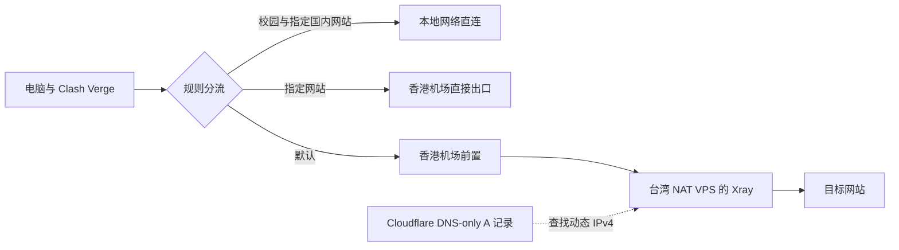

# 脱敏实例：香港机场前置 → 台湾 HiNet 出口

> 这是历史实例，不是可直接导入的配置。`xxx` 代表已隐藏或待填写的真实信息；端口和节点必须重新读取，服务状态与 DNS 结果也会变化。不得从此示例推断新 VPS 的端口映射或住宅 IP 属性。

## 组成

- 客户端：Clash Verge/Mihomo，规则模式；该次验证使用 TUN 与 fake-ip。机场 `proxy-provider` 定期获取节点，多个香港节点可手选、低延迟选择或故障切换。使用 `dialer-proxy` 让台湾 VMess/TCP 节点经香港前置。
- 台湾：HiNet 动态 IPv4 的 NAT VPS，外部端口分别映射到容器内主/备用 Xray 服务。还有一个 IPv6 备用入口。当前结构包含一组主入口与多个备用入口；具体地址、端口与 UUID 为 `xxx`。
- 固定选择与自动切换是不同状态：选择具体的香港节点/台湾端口时不会自动等同于选中 fallback 组；多个台湾端口仍然依赖同一台 VPS。
- 路由：校园和部分国内域名直连，Threads 走香港前置，其他未命中流量默认走台湾。自定义规则放在 `MATCH` 前；`MATCH` 后追加规则可能不会匹配。例子中的手动扩展只在对应本地客户端生效。

## DNS 与 DDNS

- 客户端：节点与 DNS 自举有专用解析，常规域名使用台湾 Quad101 加密 DNS，并通过台湾串联策略组访问。该配置不证明每个浏览器/应用都遵循同一路径。
- VPS：Xray 的 Freedom 出站使用内置 DNS；优先 Quad101 DoH，解析失败时回退 Google DoH。DNS 端点名称通过受控地址自举并校验证书，`ForceIPv4v6` 优先 IPv4、仅在适当条件下尝试 IPv6。Quad101 存在过滤及个别域名解析失败的情况，应测试并披露。
- 動态 IP：VPS 定时检查 IPv4，Cloudflare API 更新 DNS-only A 记录 `xxx`；需要校验入站映射地址是否等于探测到的出站 IP。IPv6 节点当时为硬编码地址，A 记录更新不会自动改变它。

## 曾经观测到的故障与启发

关闭 Chrome 安全 DNS 后，浏览器检测仍可能看到非台湾解析器：客户端 Clash 的 Quad101 查询正常，不表示使用 HTTP 代理发送的目标域名不会再由 VPS 出站解析。排查时检查浏览器、客户端、代理协议、VPS 进程和上游 DNS；以真实浏览器测试结果为准。调整 VPS 端 DNS 后，曾在两个检测站点观察到台湾解析器；地区与结果可变，不是永久保证。

## 官方参考

- [Mihomo DNS 配置](https://wiki.metacubex.one/config/dns/)
- [Xray DNS 配置](https://xtls.github.io/config/dns/)
- [Xray Sockopt 与域名策略](https://xtls.github.io/config/transports/sockopt/)
